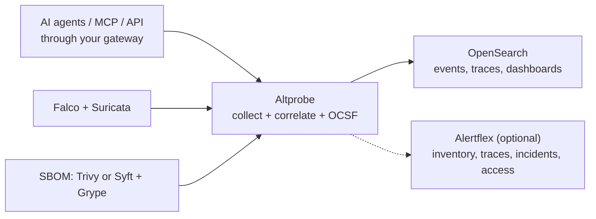
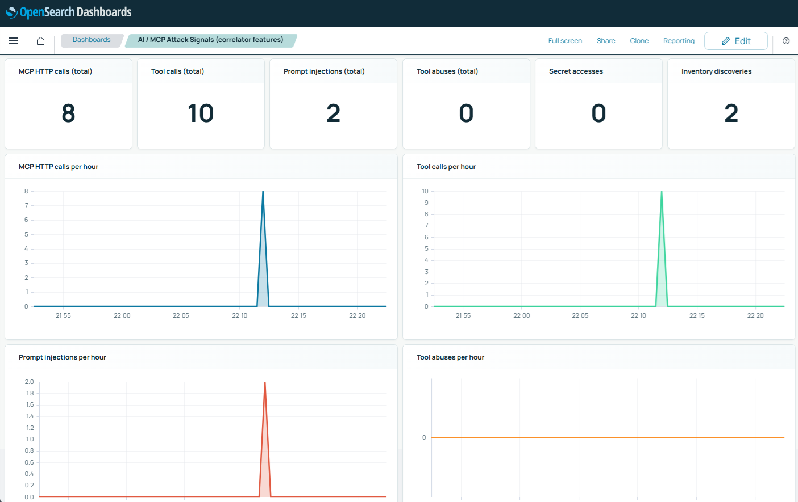
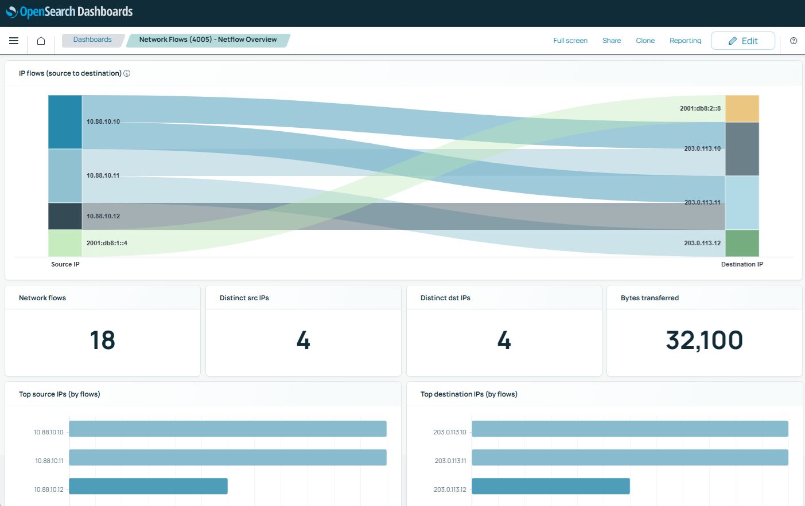

# Altprobe

Altprobe is a free collector for AI, MCP, REST API and gateway traffic. It
collects events from the gateways you already run, normalizes them to OCSF, and
sends security events, OTEL traces and agent software vulnerability findings to
OpenSearch. Alertflex is optional. Add Alertflex for MCP/API inventory, traces, 
incidents, AI explanations and access management.

Search events in OpenSearch; use Alertflex to investigate traces and incidents, 
get AI explanations and manage access.

## What Altprobe provides

- Gateway traffic analysis for LLM, MCP and API calls, with prebuilt Altprobe
  rules and OWASP CRS; Qwen3Guard is optional.
- Direct AI egress detection by correlating Suricata network events with Falco
  process and container events.
- SBOM-based software composition analysis with Trivy or Syft + Grype.
- Security events in OCSF, with field mappings for OpenSearch Security Analytics.
- All collected OTEL traces in OTLP/JSON, from built-in collection or external
  OTLP sources.
- Six gateway labs with tests, sample traffic and 70+ IDS rules.

## How it works



The collector is a single Linux service. It reads gateway logs or Redis lists,
optional IDS events and SBOM reports; it writes OCSF findings and OTEL spans to
OpenSearch.

## Supported gateways

| Gateway | Connector | Lab |
|---|---|---|
| APISIX | [`connectors/apisix`](connectors/apisix/README.md) | [`labs/lab_apisix`](labs/lab_apisix/README.md) |
| Envoy | [`connectors/envoy`](connectors/envoy/README.md) | [`labs/lab_envoy`](labs/lab_envoy/README.md) |
| OpenResty | [`connectors/openresty`](connectors/openresty/README.md) | [`labs/lab_openresty`](labs/lab_openresty/README.md) |
| Kong OSS | [`connectors/kong`](connectors/kong/README.md) | [`labs/lab_kong`](labs/lab_kong/README.md) |
| Traefik | [`connectors/traefik`](connectors/traefik/README.md) | [`labs/lab_traefik`](labs/lab_traefik/README.md) |
| Higress | [`connectors/higress`](connectors/higress/README.md) | [`labs/lab_higress`](labs/lab_higress/README.md) |

## Quick start

Start with APISIX:

```bash
git clone https://github.com/olegzhr/altprobe.git
cd altprobe/labs/lab_apisix
docker compose up -d --build --wait --wait-timeout 600
```

Open:

- Gateway: `http://localhost:9080`
- OpenSearch: `http://localhost:9200`
- Dashboards: `http://localhost:5601/app/dashboards`
- OTEL traces: `http://localhost:5601/app/dashboards#/view/altprobe-otel-traces`

Run the smoke tests:

```bash
cd ../tests
python3 -m pip install -r requirements.txt
LAB_GATEWAY=apisix python3 run_tests.py smoke
```

Run one lab at a time; the labs share host ports. See [`labs/README.md`](labs/README.md)
for the other gateways and [`labs/tests/README.md`](labs/tests/README.md) for all
test categories.

## Dashboards

The labs provision OpenSearch Dashboards with:

- AI / MCP attack signals and tool-abuse signals;
- OCSF HTTP, API, DNS, TLS and network activity;
- source-to-destination IP flows and top talkers;
- MITRE ATT&CK / ATLAS timelines;
- vulnerability findings from SBOM scans.

### AI / MCP Attack Signals



### OCSF All Sources Overview


### Network Flows



### MITRE ATT&CK / ATLAS Timeline


### Vulnerability Findings


## Install from package

```bash
ALTPROBE_VERSION=1.0.2
ALTPROBE_RELEASE_BASE_URL="https://github.com/olegzhr/altprobe/releases/download"
ALTPROBE_SHA256=9d4106796e7bf16bbd9b789aae7c3c36742c4b2a82f69a5dd94b11a1f5b2e25a
wget "${ALTPROBE_RELEASE_BASE_URL}/v${ALTPROBE_VERSION}/altprobe_${ALTPROBE_VERSION}_amd64.deb"
echo "${ALTPROBE_SHA256}  altprobe_${ALTPROBE_VERSION}_amd64.deb" | sha256sum -c - \
  && sudo apt-get update \
  && sudo apt-get install -y "./altprobe_${ALTPROBE_VERSION}_amd64.deb" \
  && sudo ldconfig
```

Ubuntu 22.04 amd64 is the supported package target. The package includes OWASP
CRS; configure sources and sinks in `/etc/altprobe/altprobe.yaml`.

```bash
altprobe-start
altprobe-status
altprobe-stop
```

## Repository layout

- `connectors/` — gateway connectors and OpenSearch assets.
- `labs/` — six gateway labs and the outbound runtime lab.
- `ids-rules/` — Falco and Suricata rules for direct AI egress and HTTP inspection.
- `docker/` — base Altprobe container assets.
- `img/` — dashboard screenshots.

## Documentation

- [Gateway labs](labs/README.md)
- [Connectors](connectors/README.md)
- [OpenSearch assets](connectors/opensearch/README.md)
- [IDS overlay](labs/ids/README.md)
- [IDS rules](ids-rules/README.md)
- [Lab tests](labs/tests/README.md)

## Requirements

- Docker and Docker Compose for the labs.
- Ubuntu 22.04 amd64 for the package install path.
- OpenSearch or another supported sink for monitoring.

## License

Altprobe binaries and the original code and assets in this repository are
licensed under the [Apache License, Version 2.0](LICENSE). Third-party
components retain their respective licenses and notices.
