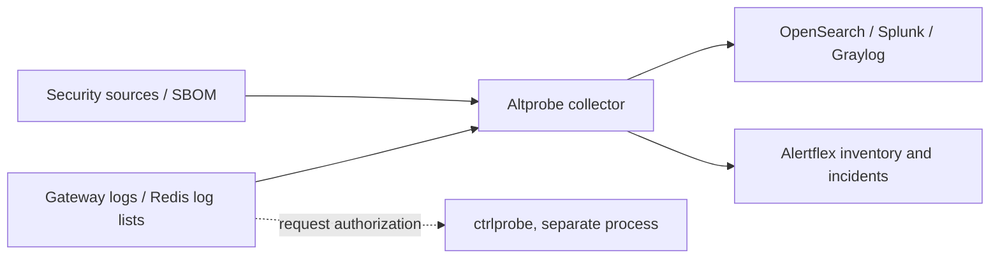
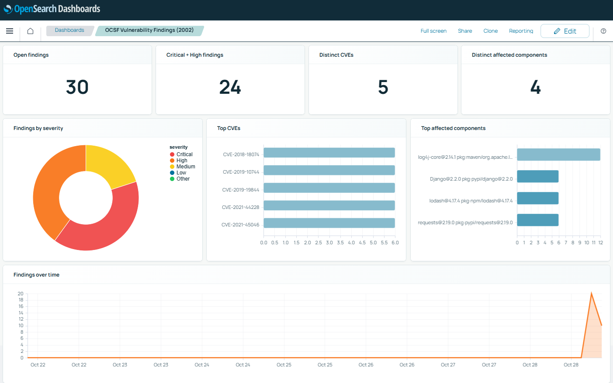

<div align="center">

# Altprobe 1.0.2


[](https://alertflex.org)


</div>

Altprobe is an open-source **collector and correlator** for AI, MCP, API and
gateway traffic. It ingests telemetry from the gateways, network sensors, agent
sandboxes and scanners you already run, normalizes every event into **OCSF
1.8.0** and delivers it to the SIEM you already have. Two detection layers are
built in: **Guardrails** for LLM traffic and a **prebuilt WAF** based on the
OWASP Core Rule Set (CRS).

- **Collector** — file, Redis and OTLP inputs for gateway logs, Suricata EVE,
  OpenShell OCSF, Trivy SBOM and AI traces.
- **Correlator** — joins observations across sources into scored findings and
  incidents, maps them to MITRE ATLAS and writes Alertflex incidents for
  HIGH/CRITICAL results.
- **Guardrails** — `llm_guard` client for Ollama (Qwen3Guard) and NVIDIA NeMo
  Guardrails, plus the API Guard rule engine for MCP/A2A and API semantics.
- **Prebuilt WAF** — an embedded ModSecurity engine with the bundled OWASP CRS
  4.29.0 ruleset, activated through a ruleset configuration, so web attacks are
  detected without a separate WAF installation. API Guard adds the MCP/A2A and
  AI-endpoint rules that generic CRS does not cover.
- **OCSF 1.8.0 everywhere** — one event model for every source, with daily
  `ocsf-1.8.0-<class>-*` indexes in OpenSearch, and the same records delivered to
  Splunk HEC, Graylog GELF and Alertflex.

```text
altprobe/
  src/                  C++ collector, configuration, shared code and tests
  src/scripts/build.sh   local build, test and packaging helper
  scripts/ci/           release guards, package verification and publishing
  .github/workflows/    GitHub Actions build, test and release
  connectors/           gateway telemetry and OpenSearch integration
  labs/                 self-contained gateway, IDS and agent labs
  docker/               development builder and release-based runtime image
  ids-rules/            Suricata rules
```

This repository contains the collector and its integrations. See
[Build from source](docs/build.md) for native builds, tests and Debian packaging.
`bash src/scripts/build.sh` configures, compiles and runs CTest locally; the
same verification runs in GitHub Actions on hosted runners.
Alertflex is an optional destination for inventory, incidents and endpoint policy
decisions — see
[Alertflex: shadow AI, MCP drift and endpoint policy](#alertflex-shadow-ai-mcp-drift-and-endpoint-policy).
The collector also exports to OpenSearch, Splunk HEC and Graylog GELF.



## AI infrastructure monitoring

Altprobe covers the telemetry surface of an AI deployment rather than a single
gateway:

| Capability | What Altprobe observes |
|---|---|
| AI gateway traffic | APISIX, Envoy/Agent Router, Kong, Traefik and Higress request/response metadata, HTTP activity, MCP profile |
| MCP and A2A actions | Tool calls, agent-to-agent calls, credential and data-transfer patterns through API Guard |
| LLM content | Captured request/response bodies assessed by Guardrails (Qwen3Guard through Ollama, or NeMo Guardrails) as OCSF 6003 evidence |
| Model provider egress | TLS SNI and HTTP host evidence from Suricata, including direct connections to AI providers |
| Agent sandbox | OpenShell native OCSF including network correlation for sandboxed agents |
| Agent supply chain | Trivy CycloneDX results as OCSF 2002 vulnerability findings per image and asset |
| Distributed traces | OTLP traces over gRPC/HTTP from AI services, with a durable spool |
| Cross-source decisions | Correlator scoring, MITRE ATLAS mapping and Alertflex incidents |

## Sources and SIEM destinations

Every source is normalized into OCSF 1.8.0 and delivered to all enabled log
sinks. Sinks are independent: enable any combination of OpenSearch, Splunk,
Graylog and Alertflex, and filter the OCSF, HTTP and OTEL streams per sink with
`*_types`.

| Source | Input | OCSF 1.8.0 output | OpenSearch | Splunk HEC | Graylog GELF | Alertflex | Lab |
|---|---|---|---|---|---|---|---|
| APISIX, Kong, Traefik, Envoy, Higress | Gateway logs, file or Redis list (`proxy_log` / `proxy_redis`) | 4002 HTTP Activity | yes | yes | yes | incidents | `lab_apisix`, `lab_kong`, `lab_traefik`, `lab_envoy`, `lab_higress` |
| Prebuilt WAF (ModSecurity + OWASP CRS) | CRS verdicts for proxied requests and responses | 2004 Detection Finding | yes | yes | yes | incidents | gateway labs |
| API Guard (MCP/A2A semantics) | Parsed request metadata and bodies | 6003 API Activity | yes | yes | yes | incidents | gateway labs |
| Correlator | Findings joined across all sources | 6003 API Activity | yes | yes | yes | incidents | all labs |
| Suricata | EVE JSON, file or Redis (`suricata_log` / `suricata_redis`) | 4001 DNS, 4002 HTTP, 4005 flow, 4007 TLS, 2004 alerts | yes | yes | yes | incidents | `lab_suricata` |
| OpenShell | Native OCSF JSONL, file or Redis | original OCSF classes | yes | yes | yes | incidents | `lab_openshell` |
| Trivy SBOM | CycloneDX scan output | 2002 Vulnerability Finding | yes | yes | yes | incidents | `lab_sbom` |
| Guardrails (Ollama / NeMo) | Captured request/response bodies | 6003 API Activity | yes | yes | yes | incidents | `lab_nemo` |
| OTLP traces | gRPC 4317 / HTTP 4318 from AI services | OTLP/JSON spans | yes | yes | yes | traces | — |

`incidents` means that HIGH/CRITICAL findings are exported through the Alertflex
incident API when `sinks.alertflex.incident_enabled` is set. Alertflex is not a
log sink: it receives inventory and API counters, incidents and
Alertflex-triggered traces.

## Sink configuration

| Sink | Protocol | Configuration | Streams and delivery |
|---|---|---|---|
| OpenSearch | HTTP/HTTPS `_bulk`, daily `ocsf-1.8.0-<class>-*` indexes | `sinks.os_url`, `os_user`, `os_pwd`, `os_tls_*`, `os_types` | `OCSF`, `HTTP`, `OTEL`; traces use a durable spool |
| Splunk | HEC JSON, one event per object | `sinks.splunk_url`, `splunk_token`, `splunk_index`, `splunk_tls_*`, `splunk_types` | `OCSF`, `HTTP`, `OTEL` |
| Graylog | GELF 1.1 over HTTP | `sinks.graylog_url`, `graylog_tls_*`, `graylog_types` | `OCSF`, `HTTP`, `OTEL`; raw record in `full_message`, `_ocsf_class_uid`, `_stream`, `_altprobe_source`, `_project_id`, `_pipeline` as fields |
| Alertflex | REST API with collector key | `sinks.af_url`, `af_key`, `sinks.alertflex.*` | inventory and API counters, incidents, triggered traces |

## Alertflex: shadow AI, MCP drift and endpoint policy

Altprobe collects, normalizes and correlates; it does not decide. If you need to
act on what Altprobe sees — find shadow AI, follow MCP drift and control endpoints
with policy — consider [Alertflex](https://alertflex.org), the decision layer that
consumes these events:

- **Shadow AI discovery** — AI providers, gateways, MCP servers and agents that
  appear in traffic or traces but are absent from the approved inventory, shown
  with the asset, project and consumer that produced the connection.
- **MCP drift** — changes in MCP servers, tools and tool descriptions compared
  with the approved baseline, so a mutated tool schema or a new server does not
  silently inherit trust. API Guard findings and gateway observations are the
  evidence.
- **Endpoint policy control** — per-endpoint `allow` / `approve` / `block`
  decisions, consumer keys, key rotation and token quotas, delivered to ctrlprobe
  as a versioned policy snapshot and applied synchronously at the gateway.
- **Risk and response** — correlation across all connected sources, MITRE ATLAS
  mapping, incidents with audit, and automatic block on risk thresholds.

Altprobe produces the evidence for these decisions: OCSF 1.8.0 records with
consumer and asset identity, API Guard MCP/A2A findings, CRS findings, SBOM
findings and traces. Set `sinks.af_url` and `af_key` to send inventory and API
counters, and enable `sinks.alertflex.incident_enabled` to export HIGH/CRITICAL
findings as Alertflex incidents. Everything else can stay in your SIEM — both
paths work independently.

## Detections

### Prebuilt WAF

The Debian package ships an embedded ModSecurity engine and the OWASP Core Rule
Set 4.29.0 rules under `/etc/altprobe/coreruleset`, so no separate WAF has to be
installed. CRS is activated by creating `crs-setup.conf` from the bundled
`crs-setup.conf.example` and pointing `altprobe.ruleset_path`
(`ALTPROBE_RULESET_PATH`, default `/etc/altprobe/coreruleset`) at the ruleset;
[`labs/common/altprobe/Dockerfile`](labs/common/altprobe/Dockerfile) does exactly
that and adds the lab `secret_access.conf` rules. Without `crs-setup.conf` the
collector starts with CRS disabled and logs the reason.

Requests and responses are inspected in the collector process; verdicts are
emitted as OCSF 2004 Detection Findings, and the CRS verdict takes priority over
any other rule attribution. An offline package build can bundle a local CRS
archive with `ALTPROBE_CRS_ARCHIVE` and `ALTPROBE_CRS_ARCHIVE_SHA256`.

### API Guard

API Guard is the semantic detector for API, MCP and A2A traffic. It keeps the
curated baseline ruleset `api-guard-baseline-v2.5` (122 rules) in
`etc/api_guard.yaml`; generic SQLi, XSS and path-traversal rules are
intentionally left to CRS. Rules cover tool abuse, credential transfer, data
exfiltration, MCP method misuse and agent-to-agent calls, and produce OCSF 6003
evidence that feeds the correlator.

### Guardrails

`llm_guard` inspects captured LLM request and response bodies:

- `provider: ollama` with a Qwen3Guard GGUF model, formats `qwen3guard`, `json`
  or `binary_verdict`;
- `provider: nemo` against a NeMo Guardrails API server
  (`/v1/chat/completions` with `guardrails.config_id`), where a `Safe` verdict
  requires a completed input rail reported by NeMo. Missing rail evidence or an
  incomplete answer produces `invalid_verdict`; an explicit block remains
  `Unsafe`.

Verdicts are recorded as OCSF 6003 detection evidence alongside local API Guard
findings.

## Screenshots

| OCSF sources | AI/MCP signals |
|---|---|
|  |  |

| Network flows | Vulnerability findings |
|---|---|
|  |  |


## Install the release

The collector is distributed as `altprobe_1.0.2_amd64.deb` in the
[v1.0.2 GitHub release](https://github.com/olegzhr/altprobe/releases/tag/v1.0.2).
Download the selected release snapshot and verify its checksums before installing.

```bash
base=https://github.com/olegzhr/altprobe/releases/download
python3 labs/common/altprobe/release_metadata.py --base-url "$base" \
  --version 1.0.2 --download-dir .
sha256sum -c SHA256SUMS
sudo apt-get install -y ./altprobe_1.0.2_amd64.deb
```

The container image is built from the same verified package:

```bash
digest=$(python3 labs/common/altprobe/release_metadata.py --base-url "$base" \
  --version 1.0.2 --print-package-sha256)
docker build -f docker/Dockerfile --build-arg ALTPROBE_PACKAGE_SHA256="$digest" -t altprobe:release .
```

Both the image and every lab record the release package digest and the installed
binary digest in `/usr/local/share/altprobe/release-receipt.json`.

## Labs

All labs have Docker Compose stacks under [`labs/`](labs/README.md).
Every lab installs the published Altprobe release package through
[`labs/common/altprobe/Dockerfile`](labs/common/altprobe/Dockerfile) and verifies it
against the release `SHA256SUMS`.

| Lab | Focus |
|---|---|
| [`lab_apisix`](labs/lab_apisix/README.md) | APISIX gateway telemetry and the prebuilt WAF |
| [`lab_envoy`](labs/lab_envoy/README.md) | Envoy AI Gateway |
| [`lab_higress`](labs/lab_higress/README.md) | Higress gateway |
| [`lab_kong`](labs/lab_kong/README.md) | Kong OSS |
| [`lab_sbom`](labs/lab_sbom/README.md) | Trivy SBOM and OCSF vulnerability findings |
| [`lab_traefik`](labs/lab_traefik/README.md) | Traefik |
| [`lab_suricata`](labs/lab_suricata/README.md) | Suricata TLS/DNS/flow and OCSF telemetry |
| [`lab_nemo`](labs/lab_nemo/README.md) | NeMo Guardrails with LangChain, APISIX and a mock LLM |
| [`lab_openshell`](labs/lab_openshell/README.md) | NVIDIA OpenShell OCSF telemetry |

Five gateway labs share [`labs/tests`](labs/tests/README.md). The source labs
NeMo, SBOM and Suricata use the run-scoped runner below; OpenShell additionally
requires its CLI, gateway and a Linux kernel with Landlock support.

## Configuration

See the `altprobe.yaml` shipped in the release package (installed as
`/etc/altprobe/altprobe.yaml`). Container/environment mode
uses the existing `ALTPROBE_*`, `SOURCES_*`, `SINKS_*` and trace settings.
Telemetry's gateway namespace is now **`ALTPROBE_GATEWAY_TYPE`** /
`altprobe.gateway_type`; it no longer depends on `POLICY_TYPE_AGENT`.

Altprobe does not open an HTTP authorization listener. Move the policy section
and ext_authz destination to ctrlprobe before replacing an existing combined
deployment. Configure OTLP collection independently when needed.
An old `policy.enabled=true` / `POLICY_ENABLED=true` setting fails collector
startup explicitly instead of pretending that authorization is still enabled.

OpenSearch, Splunk HEC and Graylog GELF HTTP are independent delivery targets.
Configure them under `sinks` (`os_*`, `splunk_*`, `graylog_*`) or with the
`SINKS_OS_*`, `SINKS_SPLUNK_*` and `SINKS_GRAYLOG_*` environment variables; each
sink selects its own `OCSF`, `HTTP` and `OTEL` streams through a `*_types` list.
Graylog receives one GELF 1.1 document per event on `graylog_url` (default
`/gelf`, port 12201): the raw OCSF or OTLP/JSON record is carried in
`full_message`, and `_ocsf_class_uid`, `_stream`, `_altprobe_source`,
`_project_id` and `_pipeline` are added as GELF fields. Graylog acknowledges with
`202 Accepted`, which the collector treats as success and stores the fields
without the GELF underscore (`ocsf_class_uid`, `stream`, `altprobe_source`,
`project_id`, `pipeline`). Parsing or routing inside Graylog is done with its own
pipeline rules.

See [Trace collection and OTLP](TRACING.md) for trace configuration.

Optional content inspection is configured under `altprobe.llm_guard` (the former
`guard_llm` / `GUARD_LLM_*` names were renamed to `llm_guard` / `LLM_GUARD_*`).
It supports
`provider: ollama` (local model) and `provider: nemo` (NVIDIA NeMo Guardrails API
server). For NeMo, set `LLM_GUARD_PROVIDER=nemo`, `LLM_GUARD_URL`,
`LLM_GUARD_CONFIG_ID` and `LLM_GUARD_MODEL`; the collector submits captured
request/response bodies to `/v1/chat/completions` and records the verdict as OCSF
6003 detection evidence. Local API Guard findings are preserved. This check
happens automatically between services. See
[`labs/lab_nemo`](labs/lab_nemo/README.md).

For Ollama, use the native API root, for example `http://host.docker.internal:11434`,
`http://172.17.0.1:11434` or `http://ollama:11434`, without `/v1`.
Set `LLM_GUARD_MODEL` and `LLM_GUARD_FORMAT=qwen3guard`, `json` or `binary_verdict`.
The binary format supports request inspection only: set `LLM_GUARD_INSPECT_RESPONSE=false`.
NeMo uses `LLM_GUARD_URL=http://nemo:8000`, its config ID and model; the client
adds `/v1/chat/completions`. Response bodies are inspected as input content by
the same input rail, rather than as a native NeMo output rail.

## Scope

Altprobe collects and analyzes telemetry, including Higress gateway events.
Ctrlprobe handles synchronous access control for APISIX and Agent Router.

## Reproducible lab checks

From the repository root, choose `nemo`, `sbom` or `suricata`:

```bash
python3 labs/run_source_lab.py nemo start
python3 labs/run_source_lab.py nemo test
python3 labs/run_source_lab.py nemo stop
```

The runner installs the published release, recreates containers with a unique run
ID and records the release package digest, the installed binary hash,
config hashes, image IDs and container start times. Tests require
`.local/current-run.json`, reject drift or restarts, and filter indexed evidence
by the current run. Receipts expire after 24 hours. NeMo also checks the real
LangChain result and the mock request audit.
SBOM uses a unique asset per run; Suricata checks the current sidecar run
and command marker. Volumes, local PKI and Trivy cache survive `stop`.

Offline regressions, without laboratory services:

```bash
python3 connectors/shipper_altprobe/test_shipper.py
python3 labs/tests/test_source_runs.py
```
