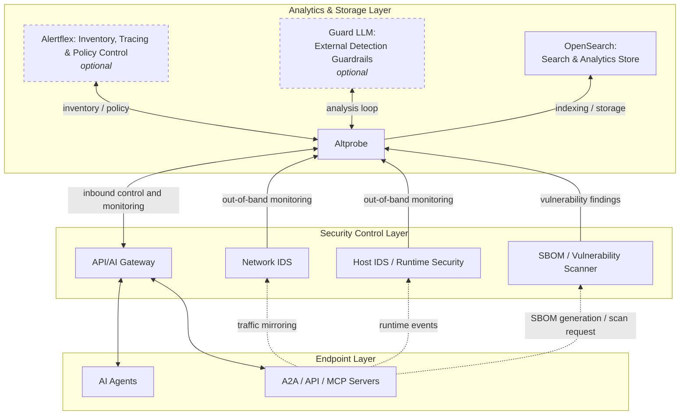
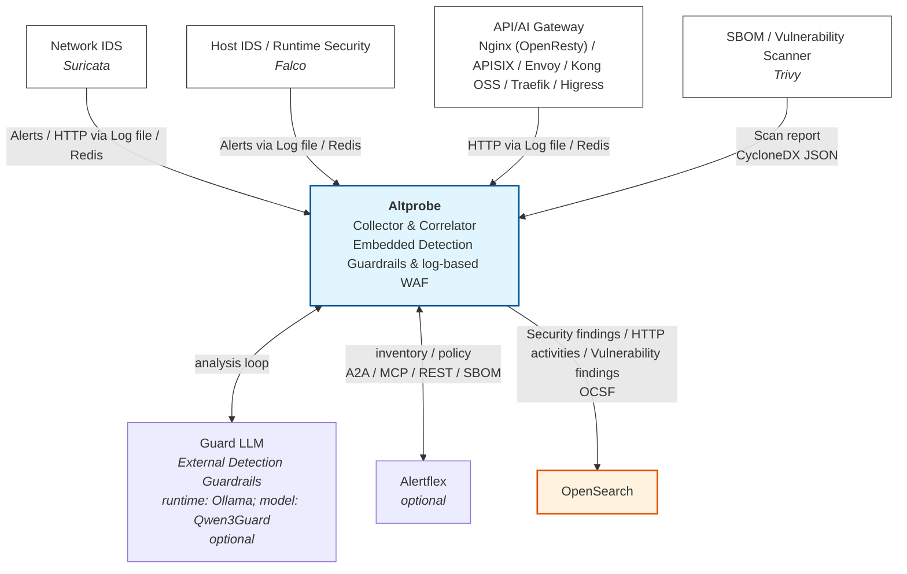
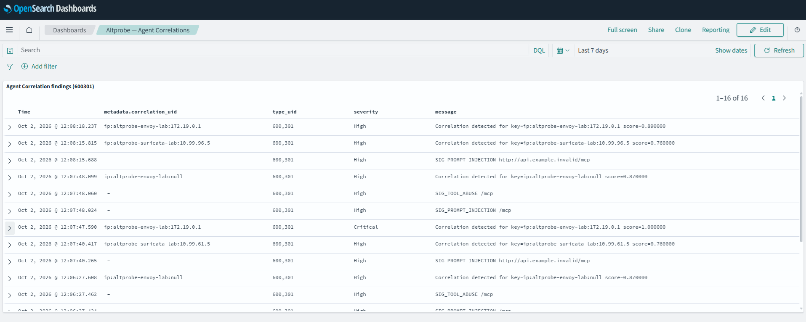
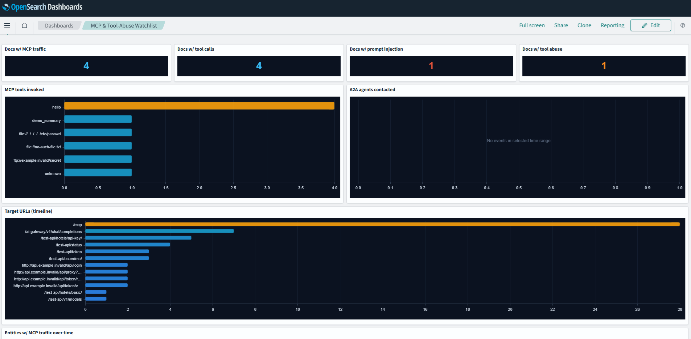
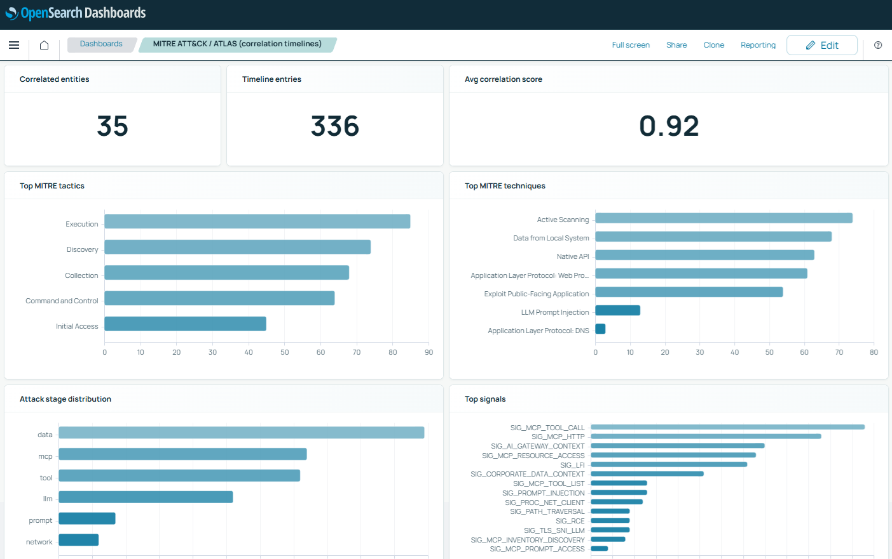
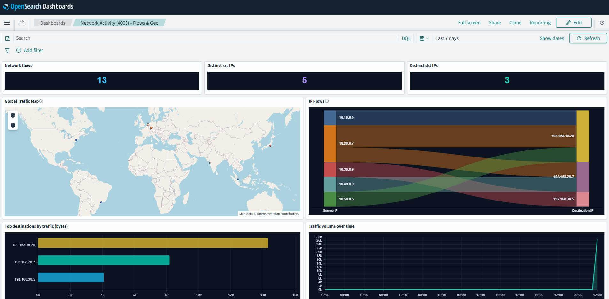
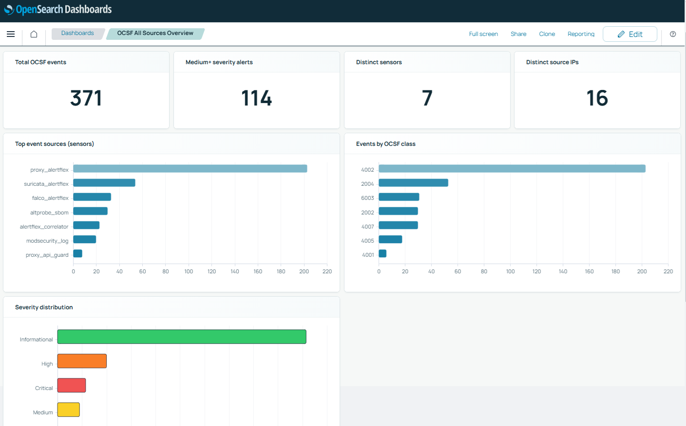
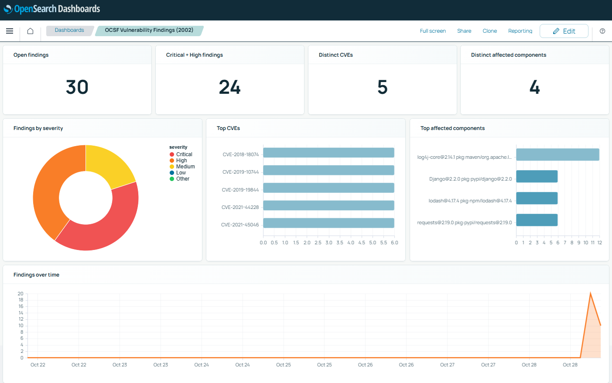

# Altprobe

Altprobe gives security and platform teams visibility into AI agent, MCP, REST API, and gateway traffic, adding detection guardrails for AI and API interactions. It collects events from gateways, proxy logs, runtime sensors, and network security tools, normalizes them into OCSF, and sends them to OpenSearch or compatible downstream systems.

It discovers AI agents, MCP servers, and APIs (including undocumented ones), identifies threats based on OWASP Top 10, and correlates them by MITRE ATT&CK / ATLAS - providing observability and detection on top of your existing stack, without requiring you to build or expand a full SIEM.

Altprobe is available as a free, ready-to-run Linux package. This repository
provides reusable gateway connectors, detection rules, deployment assets,
dashboards and self-contained labs to help you get started.

## Table of Contents

- [Architecture](#architecture)
- [Components](#components)
- [Example Screenshots](#example-screenshots)
  - [Solution Overview](#solution-overview)
  - [Agent Correlations](#agent-correlations)
  - [MITRE ATT&CK / ATLAS Timeline](#mitre-attck--atlas-timeline)
- [Why Use Altprobe](#why-use-altprobe)
- [Repository Contents](#repository-contents)
- [Requirements](#requirements)
- [Install From Package](#install-from-package)
- [Run Altprobe](#run-altprobe)
- [Quick-Start Labs](#quick-start-labs)
  - [Quickest Path](#quickest-path)
- [License](#license)

## Architecture

### High-Level Design (HLD)



### Low-Level Design (LLD)



## Components

| Component | Layer | Role | Technology |
|-----------|-------|------|------------|
| AI Agents | Endpoint | Autonomous AI workloads generating requests/actions | — |
| A2A / API / MCP Servers | Endpoint | MCP servers providing tools/context; A2A / REST endpoints | — |
| API/AI Gateway | Security Control | Front for MCP, A2A, REST; inbound control & monitoring | Nginx (OpenResty) / APISIX / Envoy / Kong OSS / Traefik / Higress |
| Network IDS | Security Control | Network intrusion detection & prevention | Suricata |
| Host IDS / Runtime Security | Security Control | Host & container intrusion detection, runtime security | Falco |
| SBOM / Vulnerability Scanner | Security Control | Generates or scans SBOMs and reports software vulnerabilities | Trivy (CycloneDX JSON) |
| Altprobe | Analytics & Storage | Collects, correlates, classifies, normalizes to OCSF; embedded WAF; Detection Guardrails (internal) | Custom: Collector / Correlator / Scanner |
| Guard LLM *(optional)* | Analytics & Storage | External Detection Guardrails: prompt/response inspection, policy enforcement, verdicts | Ollama; Qwen3Guard |
| Search & Analytics Store | Analytics & Storage | Search, dashboards, alerting on OCSF findings | OpenSearch |
| Alertflex *(optional)* | Analytics & Storage | Inventory, tracing, and policy control | Alertflex |

## Example Screenshots

The quick-start labs provision OpenSearch Dashboards so you can inspect
normalized OCSF events, agent correlations, and security timelines.

### Altprobe - Agent Correlations



### MCP & Tool-Abuse Watchlist



### MITRE ATT&CK / ATLAS Timeline



### Network Activity



### OCSF Sources



### Vulnerability findings



## Why Use Altprobe

- Monitor MCP, AI Gateway, and REST API traffic from a single collector.
- Convert heterogeneous gateway and sensor events into OCSF.
- Send normalized events to OpenSearch for search, dashboards, and alerting.
- Correlate API and agent activity by host, session, route, and request data.
- Start with a local lab, then adapt the same source and sink pattern for a
  production gateway.

## Repository Contents

- `connectors/` - reusable integration code
- `docker/` - base Docker assets for Altprobe.
- `ids-rules/` - MCP / Shadow API / AI Detection rule files for Falco, Suricata.
- `labs/` - public quick-start labs for OpenResty, APISIX, Envoy, Kong OSS, Traefik and Higress.

## Requirements

- Docker and Docker Compose for the labs.
- Ubuntu 22.04 (the package versions below are pinned for this release) for the
  Linux package install path.
- Optional: OpenSearch or another supported sink for production deployments.

## Install From Package

```bash
sudo apt-get update
sudo apt-get install -y \
    libdaemon0 \
    libboost-system1.74.0 libboost-filesystem1.74.0 libboost-regex1.74.0 \
    libboost-iostreams1.74.0 libboost-thread1.74.0 \
    libyaml-cpp0.7 libhiredis0.14 libmodsecurity3 libmaxminddb0 \
    libssl3 libgrpc++1 libprotobuf23

ALTPROBE_VERSION=1.0.2
ALTPROBE_RELEASE_BASE_URL="https://github.com/olegzhr/altprobe/releases/download"
ALTPROBE_SHA256=c89ec517fcd4ff5831cee8cb63f51e8d717f36a274868717177431baa31a0ce8
wget "${ALTPROBE_RELEASE_BASE_URL}/v${ALTPROBE_VERSION}/altprobe_${ALTPROBE_VERSION}.deb"
echo "${ALTPROBE_SHA256}  altprobe_${ALTPROBE_VERSION}.deb" | sha256sum -c - \
  && sudo dpkg -i "altprobe_${ALTPROBE_VERSION}.deb" \
  && sudo ldconfig
```

Update `/etc/altprobe/altprobe.yaml` for your sources and sinks.

## Run Altprobe

```bash
altprobe-start
altprobe-status
altprobe-stop
altprobe run
```

## Quick-Start Labs

The public labs are designed for safe local evaluation. They use harmless mock
traffic only: MCP ping/tool calls, REST demo endpoints, and a local
OpenAI-compatible response mock. They exercise integration behavior and do not
measure detection accuracy against a comprehensive attack benchmark.

Captured traffic is analyzed asynchronously. Access control uses the separate
synchronous Policy listener on configured routes; a later finding cannot undo
a request that has already reached its upstream. OpenResty's demo collects
telemetry without enabling Policy.

### Quickest Path

If you are not sure which gateway to try first, start with APISIX:

```bash
git clone https://github.com/olegzhr/altprobe.git
cd altprobe/labs/lab_apisix
docker compose build --no-cache altprobe
docker compose up -d --build --wait
cd ../tests
python3 -m pip install -r requirements.txt
LAB_BASE=http://localhost:9080 python3 run_tests.py smoke
```

Expected result: the smoke suite reports every test passed (e.g. `N passed`). Then open OpenSearch
Dashboards at `http://localhost:5601` and review the provisioned Altprobe
dashboards.

Use the same flow for any gateway:

```bash
cd <lab-directory>
docker compose build --no-cache altprobe
docker compose up -d --build --wait
cd ../tests
python3 -m pip install -r requirements.txt
LAB_BASE=<gateway-url> python3 run_tests.py smoke
```

| Gateway | Lab directory | Gateway URL | Details |
|---------|---------------|-------------|---------|
| APISIX | `labs/lab_apisix` | `http://localhost:9080` | `labs/lab_apisix/README.md` |
| Envoy | `labs/lab_envoy` | `http://localhost:9080` | `labs/lab_envoy/README.md` |
| Nginx (OpenResty) | `labs/lab_openresty` | `http://localhost:9080` | `labs/lab_openresty/README.md` |
| Kong OSS | `labs/lab_kong` | `http://localhost:9080` | `labs/lab_kong/README.md` |
| Traefik Proxy OSS | `labs/lab_traefik` | `http://localhost:9080` | `labs/lab_traefik/README.md` |
| Higress | `labs/lab_higress` | `http://localhost:9080` | `labs/lab_higress/README.md` |

All labs expose OpenSearch at `http://localhost:9200` and OpenSearch Dashboards
at `http://localhost:5601`.

## License

Altprobe collector binaries published in [GitHub Releases](https://github.com/olegzhr/altprobe/releases)
and the original code and assets in this repository are licensed under the
[Apache License, Version 2.0](LICENSE).

Third-party components retain their respective licenses and notices.
