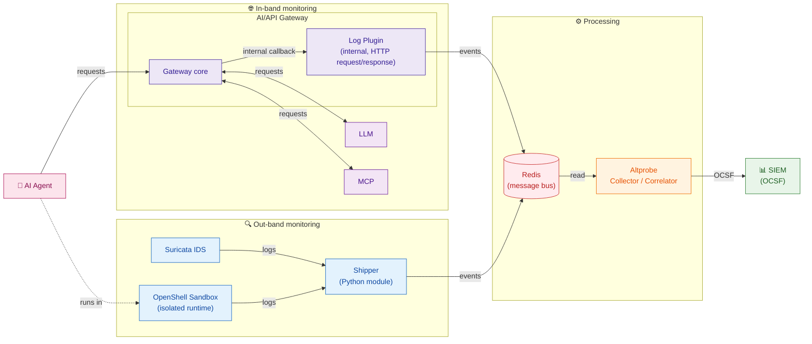
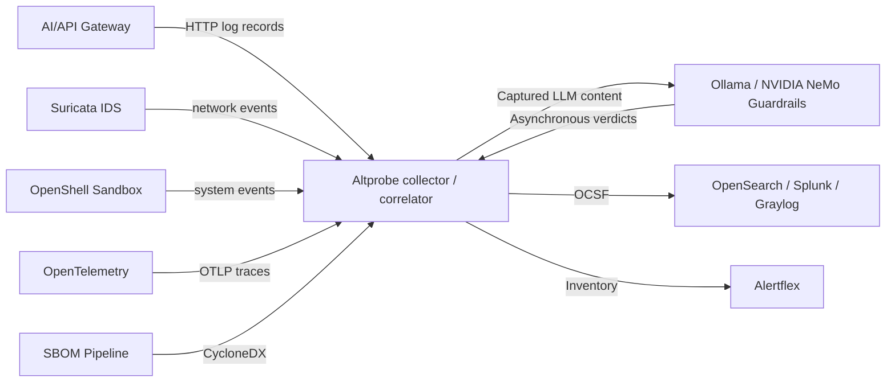
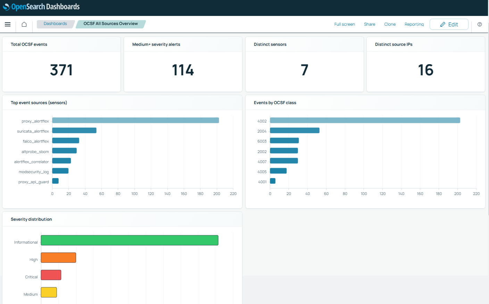
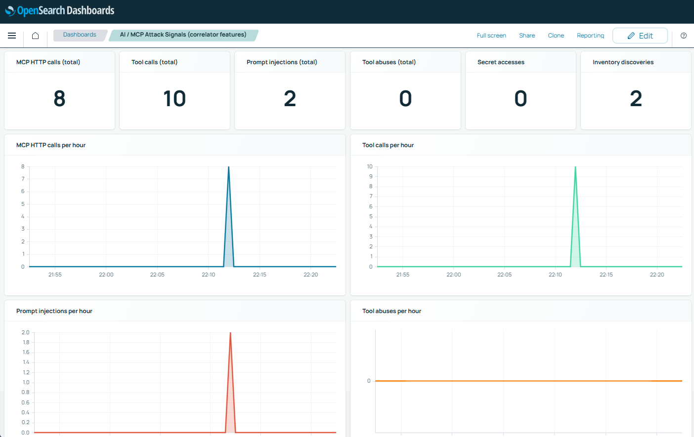
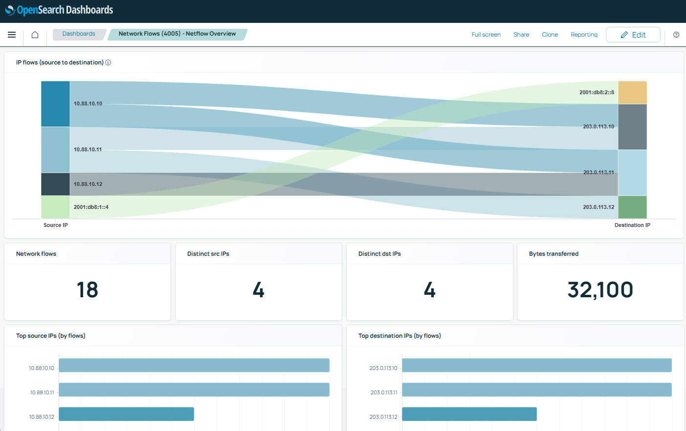
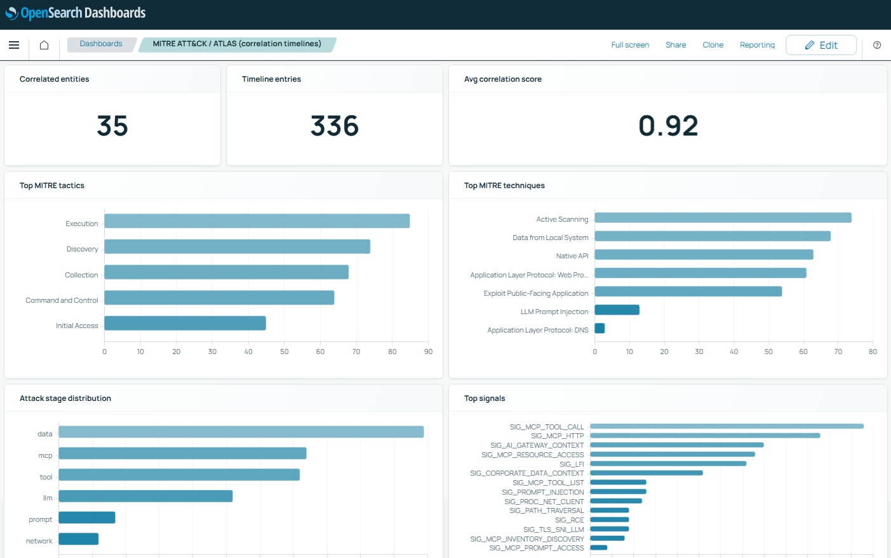

<div align="center">

# Altprobe


</div>

Altprobe is a free open-source collector and correlator for AI, MCP, REST API, and gateway traffic. It collects events from AI gateways, normalizes them into OCSF, and sends these events to OCSF-compatible SIEMs. Additionally, it can work as an OTEL traces collector and an ingester of SBOM and vulnerability scan results (CycloneDX). The optional Alertflex integration adds MCP/API inventory, incidents, Alertflex-triggered traces, and access management.

## AI infrastructure monitoring

Altprobe combines gateway, network, sandbox and application telemetry. Collection runs through two independent planes that converge on a single message bus (Redis) and are consumed by the Altprobe collector/correlator:

- **In-band** — the AI/API Gateway with an internal Log Plugin captures HTTP request/response and ships events to Redis.
- **Out-of-band** — the OpenShell Sandbox (isolated runtime for the AI Agent) and Suricata IDS ship logs through a Python **Shipper** module into Redis.



## Sources, outputs and destinations

The overview above shows the collection planes; this view details which sources feed Altprobe, what OCSF classes they produce, and where they are delivered. The Ollama / NeMo Guardrails verdict loop and the Alertflex inventory path are shown here as well.



| Capability | What Altprobe observes |
|---|---|
| AI gateway traffic | APISIX, Envoy/Agent Router, Kong, Traefik and Higress request/response metadata, HTTP activity, MCP profile |
| MCP and A2A actions | Tool calls, agent-to-agent calls, credential and data-transfer patterns through API Guard |
| LLM content | Captured request and response bodies assessed asynchronously via Ollama (Qwen3Guard) or NeMo Guardrails, with verdicts recorded as OCSF 6003 evidence |
| Model provider egress | Suricata with IDS rules flags direct connections to unknown LLM providers outside the AI Gateway — DNS, TLS SNI, HTTP host and flow evidence, including traffic that bypasses the gateway |
| Agent sandbox | Native OCSF events for process activity, application lifecycle, authentication and policy outcomes, when emitted by the sandbox or workload |
| Agent supply chain | Trivy CycloneDX results as OCSF 2002 vulnerability findings per image and asset |
| Distributed traces | OTLP traces over gRPC/HTTP from AI services, with a durable spool |
| In-band correlation | Risk scoring for application-layer activity, MITRE ATLAS mapping and optional Alertflex incident delivery |

### Out-of-band visibility

- **Sandbox runtime events.** The OpenShell integration forwards native OCSF
  from the sandbox and instrumented workloads. Depending on what the source
  emits, records can show process activity, authentication, application
  lifecycle events and policy outcomes such as denied connections.
- **Network observations.** Suricata runs with IDS rules that flag direct
  connections to unknown LLM providers outside the AI Gateway. EVE provides DNS,
  TLS SNI, HTTP host and flow metadata, so Altprobe can surface activity such as
  a service or agent contacting a model provider directly — including traffic
  that never passes through the gateway.

Altprobe exports both sources directly to the SIEM. The in-band correlator
processes HTTP and its application-layer detection signals. When a Suricata IDS
alert includes an HTTP observation, that observation can enter the HTTP
inspection pipeline.

[Suricata lab](labs/lab_suricata/README.md) · [OpenShell lab](labs/lab_openshell/README.md)

## Sources and SIEM destinations

Altprobe normalizes security events to OCSF 1.8.0 and exports traces as
OTLP/JSON. OpenSearch, Splunk and Graylog can each select their own OCSF,
HTTP and OTEL streams with `*_types`. The optional Alertflex integration
receives inventory, incidents and triggered traces.

| Source | Input | OCSF 1.8.0 output | OpenSearch | Splunk HEC | Graylog GELF | Alertflex | Lab |
|---|---|---|---|---|---|---|---|
| APISIX, Kong, Traefik, Envoy, Higress | Gateway logs, file or Redis list (`proxy_log` / `proxy_redis`) | 4002 HTTP Activity | yes | yes | yes | incidents | `lab_apisix`, `lab_kong`, `lab_traefik`, `lab_envoy`, `lab_higress` |
| Prebuilt WAF (ModSecurity + OWASP CRS) | CRS verdicts for proxied requests and responses | 2004 Detection Finding | yes | yes | yes | incidents | gateway labs |
| API Guard (MCP/A2A semantics) | Parsed request metadata and bodies | 6003 API Activity | yes | yes | yes | incidents | gateway labs |
| In-band correlator | HTTP, MCP and API events with application-layer detection signals | 6003 API Activity | yes | yes | yes | incidents | gateway labs |
| Suricata | EVE JSON, file or Redis (`suricata_log` / `suricata_redis`) | 4001 DNS, 4002 HTTP, 4005 flow, 4007 TLS, 2004 alerts | yes | yes | yes | incidents | `lab_suricata` |
| OpenShell | Native OCSF JSONL, file or Redis | original OCSF classes | yes | yes | yes | — | `lab_openshell` |
| Trivy SBOM | CycloneDX scan output | 2002 Vulnerability Finding | yes | yes | yes | incidents | `lab_sbom` |
| Guardrails (Ollama / NeMo) | Captured request/response bodies | 6003 API Activity | yes | yes | yes | incidents | `lab_nemo` |
| OTLP traces | gRPC 4317 / HTTP 4318 from AI services | OTLP/JSON spans | yes | yes | yes | traces | — |

`incidents` means that HIGH/CRITICAL findings are exported through the Alertflex
incident API when `sinks.alertflex.incident_enabled` is set. Alertflex is not a
log sink: it receives inventory and API counters, incidents and
Alertflex-triggered traces.

## Sink configuration

| Sink | Protocol | Configuration | Streams and delivery |
|---|---|---|---|
| OpenSearch | HTTP/HTTPS `_bulk`, daily `ocsf-1.8.0-<class>-*` indexes | `sinks.os_url`, `os_user`, `os_pwd`, `os_tls_*`, `os_types` | `OCSF`, `HTTP`, `OTEL`; traces use a durable spool |
| Splunk | HEC JSON, one event per object | `sinks.splunk_url`, `splunk_token`, `splunk_index`, `splunk_tls_*`, `splunk_types` | `OCSF`, `HTTP`, `OTEL` |
| Graylog | GELF 1.1 over HTTP | `sinks.graylog_url`, `graylog_tls_*`, `graylog_types` | `OCSF`, `HTTP`, `OTEL`; raw record in `full_message`, `_ocsf_class_uid`, `_stream`, `_altprobe_source`, `_project_id`, `_pipeline` as fields |
| Alertflex | REST API with collector key | `sinks.af_url`, `af_key`, `sinks.alertflex.*` | inventory and API counters, incidents, triggered traces |

## Alertflex: shadow AI, MCP drift and endpoint policy

Altprobe collects, normalizes and correlates; it does not decide. If you need to
act on what Altprobe sees — find shadow AI, follow MCP drift and control endpoints
with policy — consider [Alertflex](https://alertflex.org), the decision layer that
consumes these events.
Altprobe produces the evidence for these decisions: OCSF 1.8.0 records with
consumer and asset identity, API Guard MCP/A2A findings, CRS findings, SBOM
findings and traces. Set `sinks.af_url` and `af_key` to send inventory and API
counters, and enable `sinks.alertflex.incident_enabled` to export HIGH/CRITICAL
findings as Alertflex incidents. Everything else can stay in your SIEM — both
paths work independently.

## Detections

### Prebuilt WAF

The Debian package ships an embedded ModSecurity engine and the OWASP Core Rule
Set 4.29.0 rules under `/etc/altprobe/coreruleset`, so no separate WAF has to be
installed. CRS is activated by creating `crs-setup.conf` from the bundled
`crs-setup.conf.example` and pointing `altprobe.ruleset_path`
(`ALTPROBE_RULESET_PATH`, default `/etc/altprobe/coreruleset`) at the ruleset;
[`labs/common/altprobe/Dockerfile`](labs/common/altprobe/Dockerfile) does exactly
that and adds the lab `secret_access.conf` rules. Without `crs-setup.conf` the
collector starts with CRS disabled and logs the reason.

Requests and responses are inspected in the collector process; verdicts are
emitted as OCSF 2004 Detection Findings, and the CRS verdict takes priority over
any other rule attribution.

### API Guard

API Guard is the semantic detector for API, MCP and A2A traffic. It keeps the
curated baseline ruleset `api-guard-baseline-v2.5` (122 rules) in
`etc/api_guard.yaml`; generic SQLi, XSS and path-traversal rules are
intentionally left to CRS. Rules cover tool abuse, credential transfer, data
exfiltration, MCP method misuse and agent-to-agent calls, and produce OCSF 6003
evidence that feeds the correlator.

### Guardrails

`llm_guard` queues captured LLM request and response bodies for asynchronous
inspection. The gateway continues handling traffic while the collector waits
for a verdict. Configure either provider:

- `provider: ollama` with a Qwen3Guard GGUF model, formats `qwen3guard`, `json`
  or `binary_verdict`;
- `provider: nemo` against a NeMo Guardrails API server
  (`/v1/chat/completions` with `guardrails.config_id`), where a `Safe` verdict
  requires a completed input rail reported by NeMo. Missing rail evidence or an
  incomplete answer produces `invalid_verdict`; an explicit block remains
  `Unsafe`.

Verdicts are recorded as OCSF 6003 detection evidence alongside local API Guard
findings.

The inspection queue is bounded. Configure its capacity with
`altprobe.llm_guard.queue_size` or `LLM_GUARD_QUEUE_SIZE` (128 by default).
When the queue is full, Altprobe drops new inspection jobs and reports
queue saturation in its log.

## Screenshots

| OCSF sources | AI/MCP signals |
|---|---|
|  |  |

| Network flows | Vulnerability findings |
|---|---|
|  |  |



## Install the release

The collector is distributed as `altprobe_1.0.2_amd64.deb` in the
[v1.0.2 GitHub release](https://github.com/olegzhr/altprobe/releases/tag/v1.0.2).
Asset names are stable, so a plain download URL always works; verify the file
against `SHA256SUMS` before installing:

```bash
base=https://github.com/olegzhr/altprobe/releases/download/v1.0.2
curl -fsSLO "$base/altprobe_1.0.2_amd64.deb"
curl -fsSLO "$base/SHA256SUMS"
sha256sum -c SHA256SUMS --ignore-missing
sudo apt-get install -y ./altprobe_1.0.2_amd64.deb
```

The same files can be fetched through the helper, which verifies every asset and
writes the digest into the image receipt:

```bash
python3 labs/common/altprobe/release_metadata.py \
  --base-url https://github.com/olegzhr/altprobe/releases/download \
  --version 1.0.2 --download-dir .
```

The container image is built from the same verified package:

```bash
digest=$(python3 labs/common/altprobe/release_metadata.py --base-url "$base" \
  --version 1.0.2 --print-package-sha256)
docker build -f docker/Dockerfile --build-arg ALTPROBE_PACKAGE_SHA256="$digest" -t altprobe:release .
```

Both the image and every lab record the release package digest and the installed
binary digest in `/usr/local/share/altprobe/release-receipt.json`.

## Labs

All labs have Docker Compose stacks under [`labs/`](labs/README.md).
Every lab installs the published Altprobe release package through
[`labs/common/altprobe/Dockerfile`](labs/common/altprobe/Dockerfile) and verifies it
against the release `SHA256SUMS`.

| Lab | Focus |
|---|---|
| [`lab_apisix`](labs/lab_apisix/README.md) | APISIX gateway telemetry and the prebuilt WAF |
| [`lab_envoy`](labs/lab_envoy/README.md) | Envoy AI Gateway |
| [`lab_higress`](labs/lab_higress/README.md) | Higress gateway |
| [`lab_kong`](labs/lab_kong/README.md) | Kong OSS |
| [`lab_traefik`](labs/lab_traefik/README.md) | Traefik |
| [`lab_nemo`](labs/lab_nemo/README.md) | NeMo Guardrails with LangChain, APISIX and a mock LLM |
| [`lab_sbom`](labs/lab_sbom/README.md) | Trivy SBOM and OCSF vulnerability findings |
| [`lab_suricata`](labs/lab_suricata/README.md) | Suricata TLS/DNS/flow and OCSF telemetry |
| [`lab_openshell`](labs/lab_openshell/README.md) | NVIDIA OpenShell OCSF telemetry |

## Configuration

See the `altprobe.yaml` shipped in the release package (installed as
`/etc/altprobe/altprobe.yaml`). Container/environment mode
uses the existing `ALTPROBE_*`, `SOURCES_*`, `SINKS_*` and trace settings.


